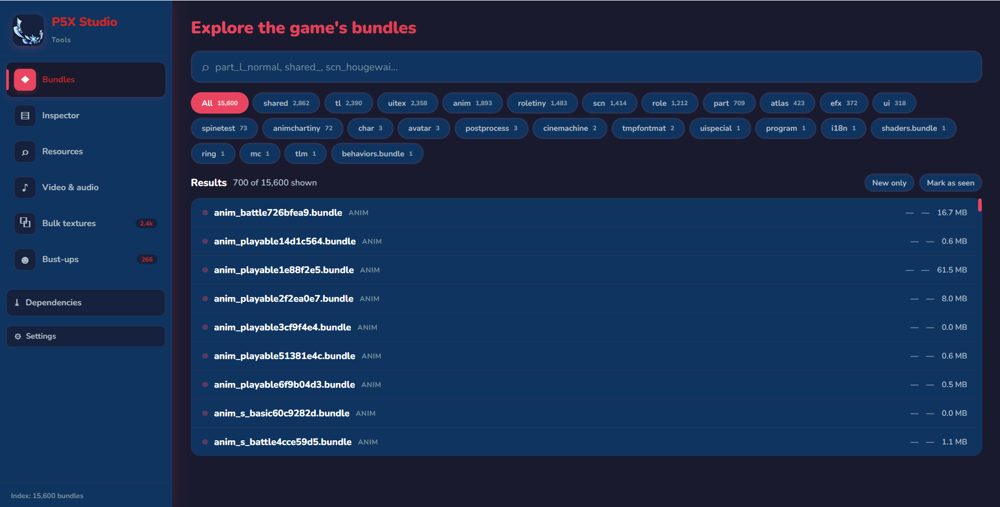
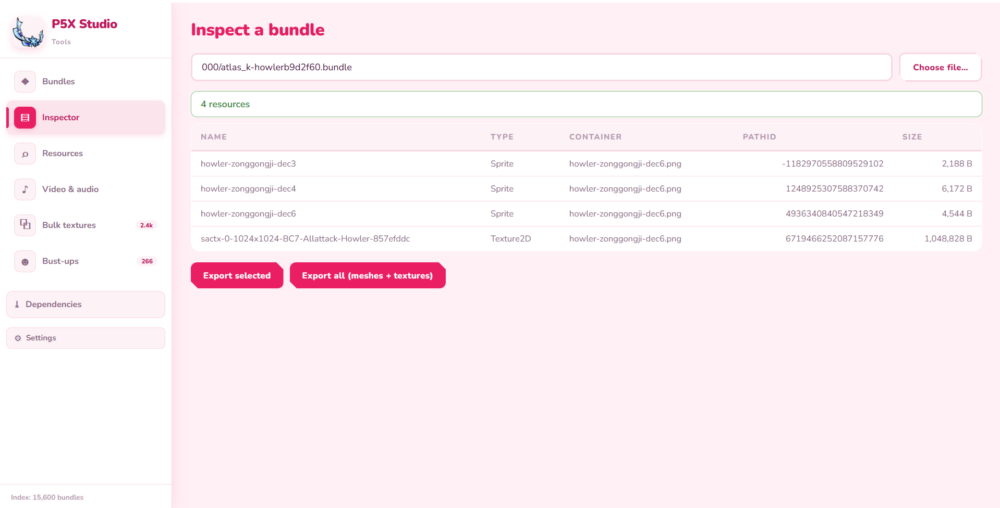
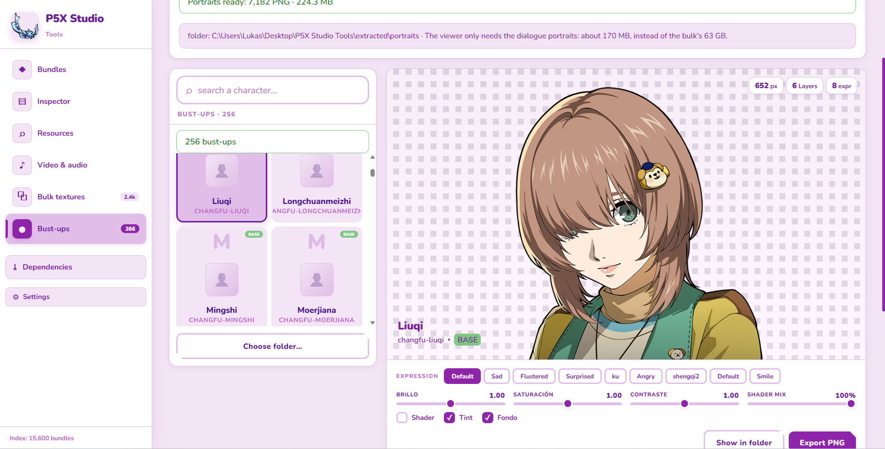
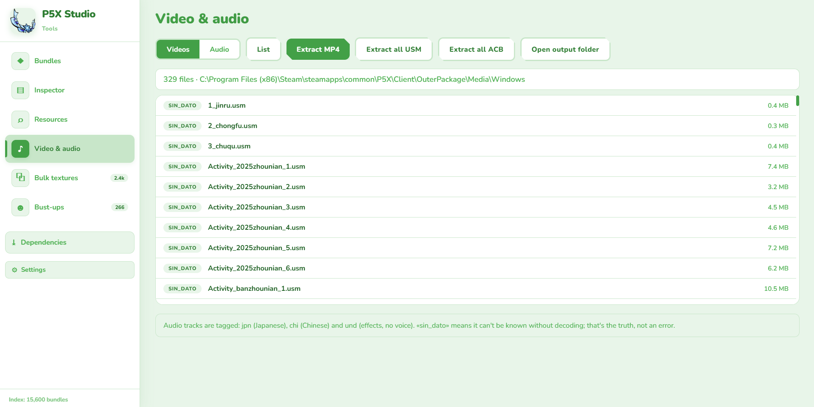
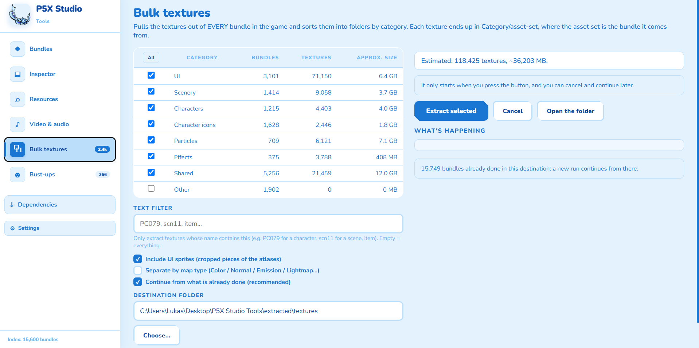
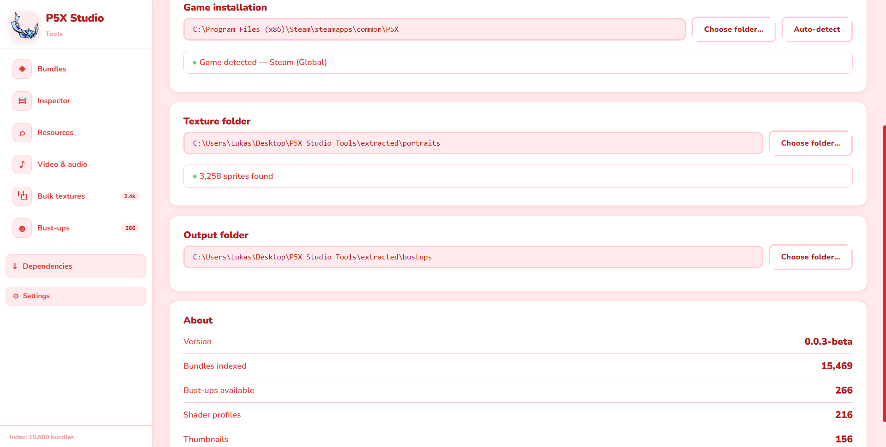
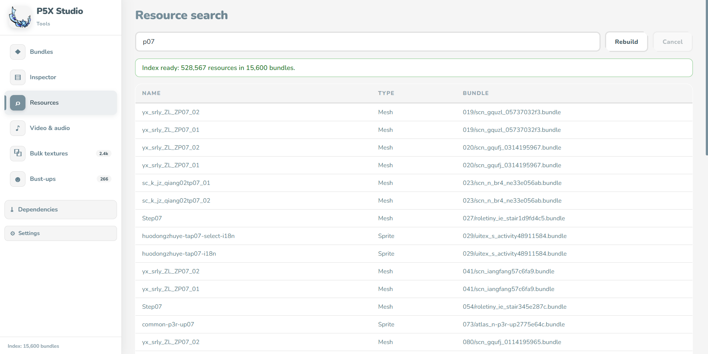
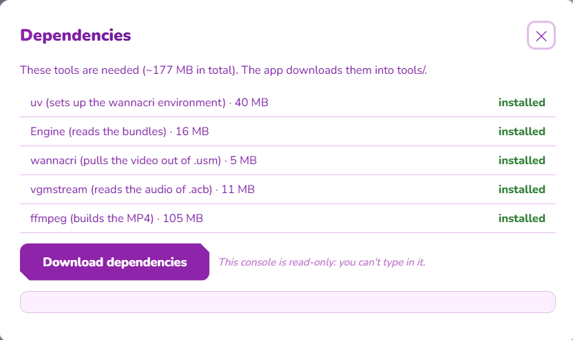

# P5X Studio Tools

Desktop tool to browse and extract stuff from Persona 5: The Phantom X (Steam global version). I got tired of opening AssetStudio and the command line every time I wanted to check a texture or rip a video, so I made this.

 

## What it does

- Browse all 15k+ bundles with search and type filters
- Open a bundle and see what's inside (meshes, textures, anims, shaders)
- Search for any asset across the whole game by name
- Extract USM videos and ACB/AWB audio
- Mass-extract textures sorted by category
- View 266 character bust-ups rendered with the actual game shader, not just the raw sprite
- Detects new bundles when the game updates
- Checks for tool updates on GitHub at startup

## Screenshots

<p align="center">
  
  
</p>

<p align="center">
  
  
</p>

<p align="center">
  
  
</p>

<p align="center">
  
  
</p>

10 themes to pick from in Settings.

## Getting it

Grab the exe from [Releases](https://github.com/Shiban-01/p5x-studio-tools/releases), drop it anywhere, and run it. It should find your P5X install on its own. If it doesn't, you can point it to the right folder in Settings.

Needs Windows 10/11 and the game installed. That's it.

## Running from source

```
git clone https://github.com/Shiban-01/p5x-studio-tools.git
cd p5x-studio-tools/p5x_studio
pip install -r requirements.txt
python -m PyInstaller "P5X Studio Tools.spec"
```

Uses Python, PyWebview for the window, UnityPy for bundle parsing, vgmstream for audio, and FFmpeg for video. All gets bundled into the exe.

## License

MIT. Don't redistribute game assets.
